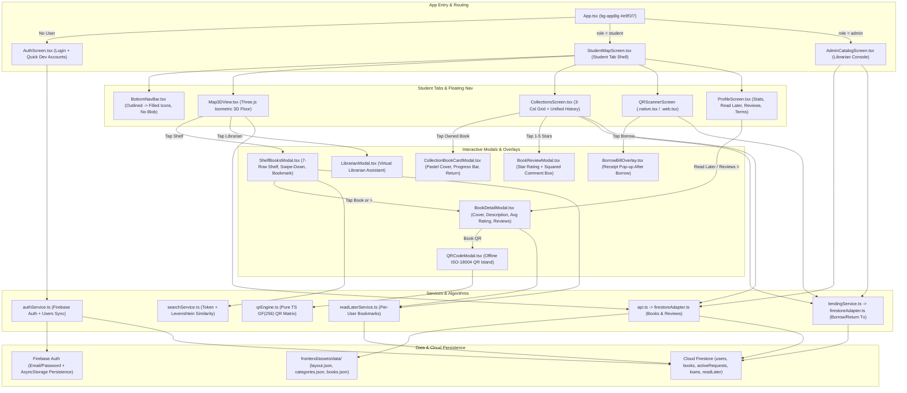
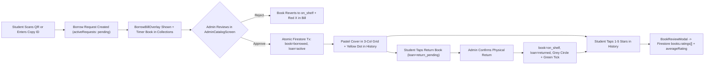

# Library Navigator — Feature & Architecture Reference

This document catalogs every feature implemented in **Library Navigator**, how each component and service is built, how data flows across the application, and **why** key architectural and UX decisions were made.

---

## 1. High-Level System Architecture

The app is built with **React Native + Expo (~58)**, **NativeWind (Tailwind CSS)** using pure functional components and zero `StyleSheet.create()` blocks, and **Cloud Firebase (Auth + Firestore)** behind clean repository interfaces (`IAuthRepository`, `IBookRepository`, `ILendingRepository`).

---

## 2. Lending, Approval & Review Lifecycle

---

## 3. Feature Catalog & Design Rationale

### 3.1 Authentication & Entry (`AuthScreen.tsx`, `authService.ts`)
- **What it does:**
  - Pure white login screen (`bg-white`) with borderless rounded-full inputs, filled `MailFilledIcon` and `LockFilledIcon`, an eye open/closed password visibility toggle (`EyeOpenIcon` / `EyeClosedIcon`), and a non-functional placeholder `Login with Google` button.
  - Upper area displays the large hero graphic (`frontend/assets/login-hero.png`), while the bottom cluster holds the heavy `Login` heading (`sans-serif-black` / `fontWeight: '900'`), a 2-tab pill slider (**Sign In** | **Quick Test Accounts**), and the form.
  - Backed by `FirebaseAuthRepository` in `frontend/src/services/authService.ts` using Firebase Email/Password authentication with `AsyncStorage` persistence on native and browser storage on web.
- **Why this was chosen:**
  - **Slider with Quick Test Accounts instead of Sign Up:** Sign-up was intentionally removed to keep campus onboarding controlled while still allowing rapid multi-user testing (Student 1, Student 2, Desk Admin) during development.
  - **Local copy of `login-hero.png` in `frontend/assets/`:** Metro bundler only resolves assets within the project root (`frontend/`), so placing the graphic inside `frontend/assets/` prevents build/syntax errors.
  - **`sans-serif-black` on Android:** Android's default Roboto font caps `fontWeight: '900'` visually unless `fontFamily: 'sans-serif-black'` is explicitly specified.

---

### 3.2 App-Wide Visual Theme & Navigation (`tailwind.config.js`, `BottomNavBar.tsx`)
- **What it does:**
  - Unified app background token `appBg: "#e9f1f7"` in `frontend/tailwind.config.js` applied across `App.tsx`, `StudentMapScreen.tsx`, `CollectionsScreen.tsx`, `ProfileScreen.tsx`, `HomeScreen.tsx`, and `AdminCatalogScreen.tsx`.
  - Floating bottom navigation bar (`BottomNavBar.tsx`) with 4 tabs: **Home**, **Collections** (closed book icon), **Scan QR**, and **Profile**. Icons render outlined when inactive (`#475569`) and solidly filled (`#0284c7`) when active, with no background pill blob.
- **Why this was chosen:**
  - **`#e9f1f7` (`appBg`):** Derived directly from the active nav pill hue (`#e0f2fe` / 204° sky blue) with saturation reduced from ~94% to ~45% at ~94% lightness, giving the entire app a calm, cohesive tint without competing with white cards or active accents.
  - **Outlined-to-filled nav icons without pill blobs:** Keeps the floating white bar minimal and immediately communicates active tab state through silhouette weight and fill rather than extra container shapes.

---

### 3.3 3D Isometric Library Map (`Map3DView.tsx`, `layout.json`, `categories.json`)
- **What it does:**
  - Interactive Three.js 3D floor inside a `WebView` rendering walls, entrance, a virtual librarian facing the left wall, and 7 color-coded shelves (`North Shelf 1` through `North Shelf 7`) grouped by category (`Computer Science`, `Electronics`, `Mechanical Engineering`, `Physics & Math`, `Civil & Structures`, `General Reference`).
  - Tapping a shelf triggers `onSelectShelf` -> opens `ShelfBooksModal`; tapping the librarian opens `LibrarianModal`.
- **Why this was chosen:**
  - **Three.js inside WebView:** Avoids native OpenGL/Expo GL version fragility across Expo Go devices while delivering smooth orbit/zoom and raycast tap selection across iOS, Android, and Web.
  - **Direction + Number shelf naming (`North Shelf 1..7`):** Replaced narrow subject bays with floor-direction numbering and category color coding, keeping internal `shelfId`s (`SH-CS-1`, `SH-CS-2`, etc.) hidden from students so existing book/loan foreign keys never break.

---

### 3.4 Shelf Browser, 7-Row Grouping & Similarity Search (`ShelfBooksModal.tsx`, `searchService.ts`)
- **What it does:**
  - Pure white bottom sheet (`rounded-t-lg`, no 24px corners, no enclosing white boxes) with an explicit translucent `<` back button in the screen top-left above the sheet, plus sensitive swipe-down-to-close gestures (`headerPanResponder` + `cardPanResponder`).
  - Header displays the category label, large 2-line grey bold shelf name (`North\nShelf 1`), and a solid category-colored `ButterflyIcon` with long V-shaped antennae.
  - Books are grouped into **Rows 1–7** (`Row X ————`), each showing a green (available) or greyed-out (unavailable) book icon, title/author, a **Bookmark** toggle (`ReadLaterService.toggle`), and a **`>`** button to open `BookDetailModal`.
  - Bottom search bar is a thick fill-only pill (`Search from X books`) anchored above the keyboard (`KeyboardAvoidingView`), with a soft white `LinearGradient` fade above it and a contextual search button (grey when empty, blue when typed) when focused.
  - Search uses `searchBooksBySimilarity` (`searchService.ts`) combining word-order-independent tokenization, substring matching, and Levenshtein edit distance.
- **Why this was chosen:**
  - **`animationType="fade"` + `Animated.spring`/`timing`:** Using React Native's `animationType="slide"` alongside `PanResponder` `translateY` caused a snap-back and double slide-out animation when `translateY` reset before modal unmount. Switching the modal wrapper to `fade` and letting `translateY` own the slide eliminates the jank.
  - **Bookmark + `>` replacing text availability tags:** Since green vs. greyed-out styling already communicates availability, removing redundant `"Available"` / `"Unavailable"` text freed space for one-tap Read Later bookmarking and detail navigation.

---

### 3.5 Book Details, Offline QR Island & Reviews (`BookDetailModal.tsx`, `QRCodeModal.tsx`, `qrEngine.ts`)
- **What it does:**
  - Centered floating island modal (`rounded-xl`) with a translucent `X` close button and Read Later bookmark toggle above it.
  - Displays the book's pastel first-letter cover (`PastelBookCoverIcon`), full title, author, category, description, divider line, **Book QR** button + average star rating, and a scrollable reviews box (`star rating`, `studentName • studentId`, `comment`).
  - Tapping **Book QR** opens `QRCodeModal` on top of the details card; tapping anywhere outside the QR island dismisses it.
  - QR matrices are generated completely offline in pure TypeScript (`qrEngine.ts`) using Reed-Solomon GF(256) error correction.
- **Why this was chosen:**
  - **Pure TypeScript QR Engine:** Zero native or external API dependencies, guaranteeing instant scannable shelf/copy QR labels across web and mobile.

---

### 3.6 QR Scanner & Ambient Light Detection (`QRScannerScreen.native.tsx`, `QRScannerScreen.web.tsx`, `BorrowBillOverlay.tsx`)
- **What it does:**
  - Native scanner (`expo-camera`) with a large corner-only translucent light-blue reticle (`w-72 h-72`), bare torch and keyboard toggle icons, and automatic ambient lux monitoring via `expo-sensors` (`LightSensor` on Android: `< 5 lux` red glow, `< 30 lux` yellow glow with white `"Use torch for better visibility"` text, `>= 30 lux` green icon).
  - Keyboard toggle reveals a minimalist grey `"Enter Book Copy ID"` input + light-blue magnifying glass button.
  - Scanning or entering a valid `LIB1:...` copy ID shows book details + shelf/row + circular rescan icon + **Borrow** button. Clicking **Borrow** submits a pending request and displays `BorrowBillOverlay` (receipt-style bill with status indicator, dates, `+` bulk-borrow prompt, and `"Once admin approves your request you can take your books"`).
- **Why this was chosen:**
  - **Hardware `LightSensor` over manual toggle:** Automatically warns students in dark stacks to turn on the torch without requiring manual interaction.

---

### 3.7 Virtual Librarian (`LibrarianModal.tsx`)
- **What it does:**
  - Natural-language assistant where students can ask about topics, authors, or titles, powered by `searchBooksBySimilarity` and matched against `layout.json` shelves, with direct tap-through to a shelf or book details.
- **Why this was chosen:**
  - Bridges free-form student queries directly to physical shelf coordinates (`North Shelf 1..7`) and real-time availability.

---

### 3.8 Collections, Unified History & 5-Star Reviews (`CollectionsScreen.tsx`, `CollectionBookCardModal.tsx`, `BookReviewModal.tsx`)
- **What it does:**
  - **Top 3-column grid:** Shows currently borrowed books as pastel first-letter covers (rotating pastel red/blue/green) with dashed binding seams, green/red remaining/overdue day badges, and 25-char truncated titles; pending borrow requests appear as translucent grey books with a timer icon. When empty, displays a borderless white **No books borrowed** card with a 3-step numbered vertical tutorial.
  - **Book Card Modal (`CollectionBookCardModal.tsx`):** Centered island with translucent `X` above top-left, larger cover, full title/author/category, due-date progress bar (`issueDate` to `dueDate` with YouTube-style scrubber dot), copy/pass details, and red **Return Book** button outside the card.
  - **Unified History Section:** One entry per loan (no separate borrow/return rows or `"Borrowed Book"` / `"Returned Book"` labels). Yellow dot = currently reading; grey circle with green tick + off-green title = returned. Each item has 3 rows on the left (Title, Author • Copy ID, `Mon DD/YY to Mon DD/YY`) and **5 clickable stars** on the right.
  - **Review Pop-up Island (`BookReviewModal.tsx`):** Clicking star `N` opens a squared (`rounded-lg`) modal showing `{N} out of 5 stars`, a multi-line comment box, and a bottom-right paper-plane send button that writes the review to Firestore (`books/{bookId}.ratings`).
- **Why this was chosen:**
  - **Unified single-row timeline:** Eliminated duplicate checkpoints and redundant status labels so the 3-row layout leaves clean horizontal room for inline 5-star ratings without clutter.

---

### 3.9 Profile Screen (`ProfileScreen.tsx`)
- **What it does:**
  - Borderless `bg-appBg` layout with translucent `<` back button, `Profile` header, large `112px` solid silhouette avatar (`ProfileAvatar`), heavy `26px` student name (`fontWeight: '900'`), muted email, and `Department • Student ID`.
  - Box-free inline stats row (`Active | Pending | Returned`) with `26px` heavy numbers and subtle vertical dividers, followed by equal-width inset horizontal dividers framing **Read Later**, **Reviews History**, **Terms and Conditions**, and red **Log Out** (`LogoutArrowCircleIcon`).
- **Why this was chosen:**
  - Removing enclosing cards and matching the weight/size of stat numbers to the user's name creates clear visual hierarchy while keeping navigation scannable.

---

### 3.10 Admin & Desk Console (`AdminCatalogScreen.tsx`)
- **What it does:**
  - Real-time librarian dashboard with **Catalog** (search, filter, add/edit/delete books with auto-generated `LIB1:...` IDs and shelf capacity enforcement) and **Lending Desk** (approve/reject pending borrow and return requests via atomic Firestore transactions).
- **Why this was chosen:**
  - **Atomic Firestore `runTransaction`:** Ensures book status (`on_shelf` / `borrowed` / `return_pending`), `activeRequests`, and `loans` stay strictly consistent when multiple students or librarians act concurrently.
